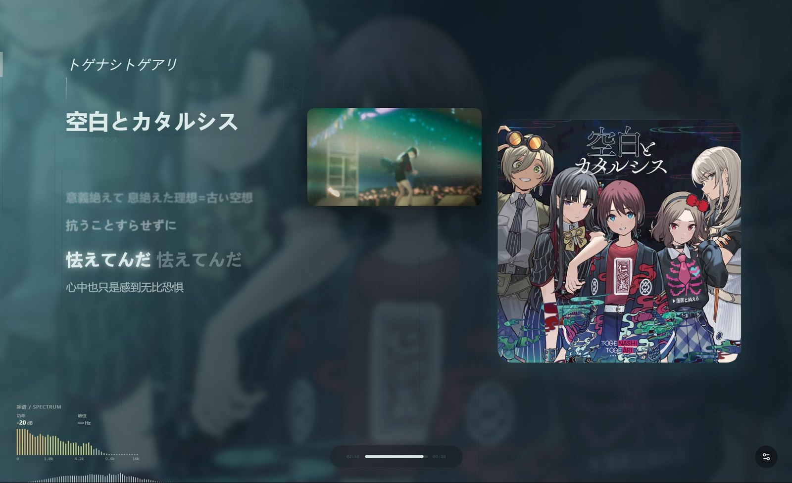
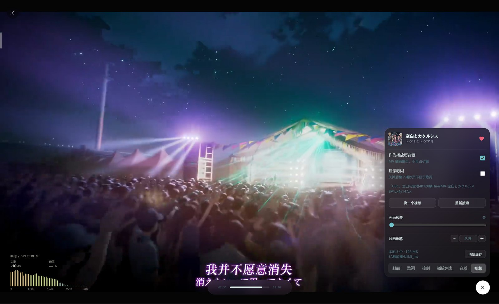
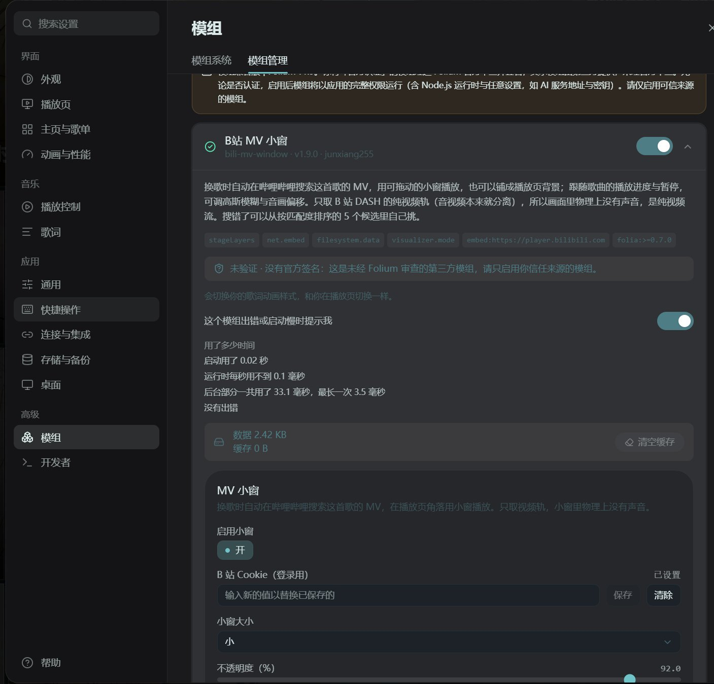
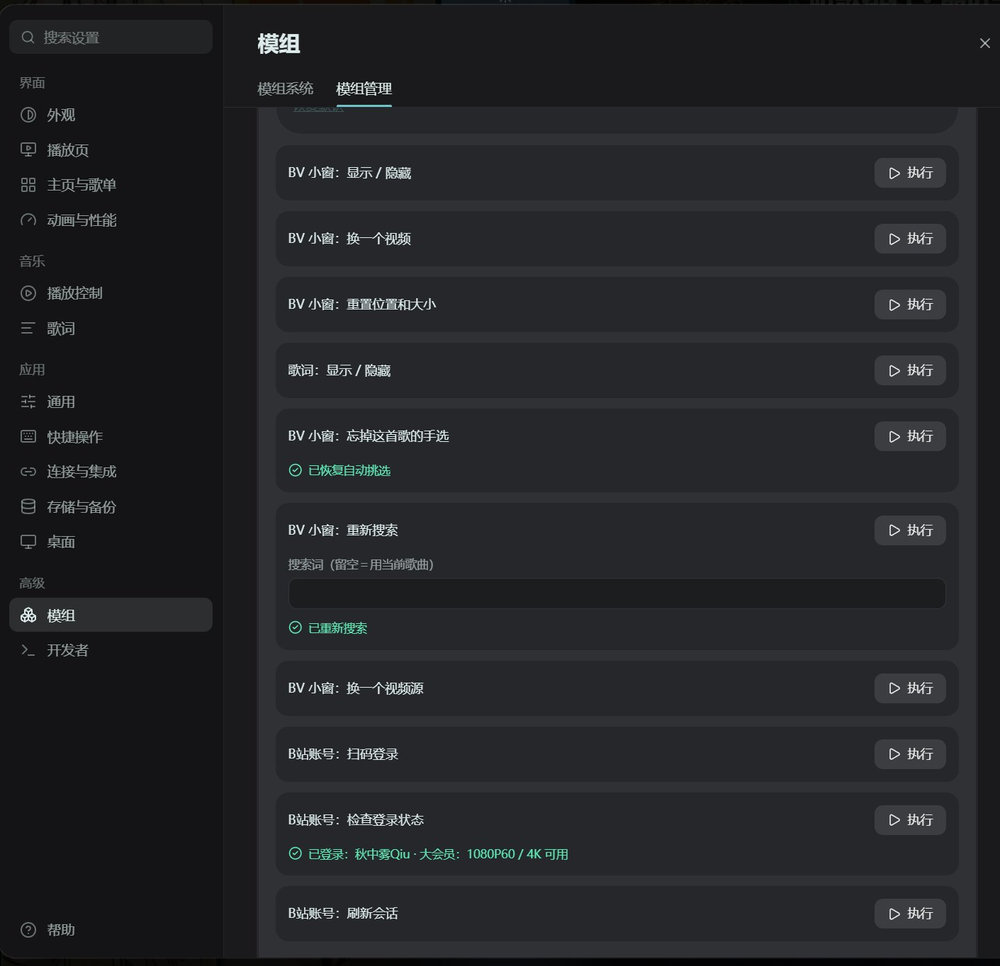

# 哔哩哔哩 MV 小窗 · `bili-mv-window`

给 Folia 的音乐播放器加一个「边听边看」：换歌时自动去 B 站找这首歌的 MV，用一个能拖动的小窗放出来。

**画面里没有声音** —— 不是靠静音糊过去的，取的本来就是 B 站 DASH 分离出来的**纯视频轨**，
播放器手里从头到尾没有音频流可放。



---

## 有什么功能

### 自动找 MV

换歌 → 拿歌名 + 歌手去 B 站搜 → 按匹配度挑一个 → 开始播。不用点任何东西。

匹配度评分是公开可调的权重：

| 维度 | 权重 |
| --- | --- |
| 标题含完整歌名 | **+62** |
| 只匹配到开头几个字 | +16 |
| 完全对不上 | −26 |
| **UP 主名字**含歌手名 | **+34** |
| 否则标题含歌手名 | +18 |
| 时长落在 45s–15min | +12 |
| 播放量（log10） | 最多 +30 |
| 标题带 MV / 官方 / 1080 / 中字 | +14 |
| 标题带 翻唱 / 伴奏 / 钢琴 / 鬼畜 | **−55** |
| 与歌曲时长差 <10s | +22 |

「UP 主含歌手名」优先于「标题含歌手名」，因为标题里堆歌手名太容易，官方号的名字才是强信号。

### 三种看法：小窗 / 背景 / 关掉

| 小窗 | 铺成播放页背景 |
| --- | --- |
|  |  |

- **小窗**：可拖动，松手就记住位置（存的是相对舞台的比例，换窗口大小也不会跑偏）。不会被拖出播放页边界。
- **三挡大小**：小 / 中 / 大，约 22% / 32% / 44% 视口宽。
- **背景模式**：MV 铺满整个播放页，小窗消失，歌词照常在上面滚。
- **不透明度**可调，淡一点不挡歌词。

### 跟播放器对齐

- **歌曲暂停，视频就停**；继续，视频接着走；切歌、停止也一样。
- **换歌时不从头播**：搜 MV 要 1.5 秒、加载流要 2 秒，这期间歌曲往前走了 —— 所以每次换源、
  每次 `loadeddata` / `canplay` 都会把视频 seek 到 `playback.position`，偏差 1.5 秒内不动它。
  拖歌曲进度条也重新对齐。
- **音画偏移**：±5000 ms，画面上有一条悬浮胶囊，鼠标移上去才浮出来：

  ```
  −   +0.3s   ＋
  ```

  单击 ±100 ms，**按住连续调**，点中间归零。**每个视频各记各的偏移** —— A 调成 −1.3s，
  切到 B 就是 B 自己的值，回到 A 还是 −1.3s。

### 选错了可以自己挑，也可以自己搜

单击小窗（或跑「BV 小窗：换一个视频」）打开候选面板：**按匹配度排 5 个**，每行标着
`歌名 ✓ +62` `UP主 ✓ +34` `匹配 174`，一眼看出为什么排这么前。

面板最下面还有一格自由搜索：

```
[ 搜点别的…                    ] [搜索]
当前：一道厦门 · Hanser
```

输入任意关键词（换语言、找翻唱、找 Live 版都行），回车即搜。**只出候选、不取流**，不会打断正在播的东西。

**选了 A 就一直是 A。** 手选会记进 `pinnedMv`，下次再放到这首歌直接用它。想恢复自动挑，
跑「BV 小窗：忘掉这首歌的手选」。

### 只有画面，没有声音

B 站的 DASH 把画面和声音存成两个独立文件：

```
dash.video[]  →  ....m4s   只有画面
dash.audio[]  →  ....m4s   只有声音
```

只取 `dash.video[]` 那一条。实测拆 box：

```
moov: 893 字节   trak 数量: 1
hdlr handler_type: [ 'vide' ]
含 soun 轨: false
```

`<video muted>` 只是第二道保险，只在最后的 `durl` 兜底源（那段是有音轨的 mp4）上才真正起作用。

### 扫码登录，解锁 1080P / 4K

命令面板跑「B站账号：扫码登录」，屏幕中间弹出一张**本地绘制的二维码**（不走任何第三方图床），
手机 B 站 App 扫一下即可。凭证走 Folium 的 `secret` 字段，由系统凭证库（DPAPI / Keychain / libsecret）加密保存，
不进设置导出、不进日志。

未登录只有 480P/360P；普通账号 1080P；大会员 1080P60 / 4K。

### 可以存到本地

| 模式 | 什么时候存 |
| --- | --- |
| 不保存 | 默认，什么不留 |
| 只存我手选的 | 你在候选面板点了哪个就存哪个 |
| 自动存匹配度最高的 | 每次第一名后台默默存一份 |

文件按 **「歌名 - 歌手」** 命名，肉眼就能看出是哪首：

```
夜曲 - 周杰伦.m4s
夜曲 - 周杰伦.json
```

开了保存之后**优先用本地**：换歌时先按「歌名 - 歌手」找文件，命中就直接放，一个网络请求都不发。
B 站视频被删了、CDN 抽风了都不影响。不想要这个行为可以关掉「优先用本地文件」，
或者干脆设成「不保存」。

存放位置可选：模组缓存目录 / 系统视频 / 系统下载 / 系统音乐 / 自定义绝对路径。
超过上限按最久没看的先删，默认 2 GB。

### 其它

- **画面模糊** 0–40px 高斯模糊，背景模式下压一点，歌词会好读很多。
- **歌词开关** 一键隐藏整个播放页的歌词。
- **嵌入播放器兜底** 直链和本地代理都拿不到字节时，退回 B 站官方 iframe（默认关，跨域没法替它静音）。

---

## 界面

设置面板和命令面板：

| 设置 | 命令 |
| --- | --- |
|  |  |

播放器面板里还有一个「视频」标签，装着背景开关、歌词开关、换视频、模糊、偏移和本地缓存管理。

---

## 安装

**A. 拖 zip**：把 `bili-mv-window-1.9.0.zip` 拖进模组面板。

**B. 放目录**：解压到 `%APPDATA%\Folia\mods\bili-mv-window\`（macOS / Linux 是 `userData/mods/`）。

然后 **设置 → 模组 → 模组系统** 打开总开关，单模组再确认一次启用。

## 权限

| 权限 | 用来干什么 |
| --- | --- |
| `stageLayers` | 在播放页上画小窗、背景层、候选面板、扫码面板 |
| `net.embed` | 只在「嵌入播放器兜底」打开时用 |
| `filesystem.data` | 记住位置、背景模式、每个视频的偏移、手选的视频、本地缓存 |
| `visualizer.mode` | 歌词开关（切到「不显示歌词」模式再切回来） |

`embedOrigins` 只声明了 `https://player.bilibili.com`。

## 取流降级链

```
1. local         本地缓存（开了「优先用本地」且命中时）
2. dash-proxy    本地 127.0.0.1 代理转发 DASH 视频轨，补 Referer   ← 纯视频，主线路
3. dash-direct   <video> 直接吃 B 站 CDN 的 m4s 直链               ← 纯视频
4. durl-proxy    重新要一份 durl 并代理转发                         ← 含音轨，强制静音
5. durl-direct   durl 直链                                          ← 含音轨，强制静音
6. embed         B 站官方 iframe（默认关闭）
```

第 4、5 步不是白写的：B 站 CDN 有一堆带端口的 PCDN 节点（`*.mcdn.bilivideo.cn:8082`），
防盗链和协议都可能让 2、3 失败，那时候宁可要一份带音轨但被死死静音的 mp4，也不要黑屏。

**为什么要本地代理**：B 站 CDN 校验 `Referer`，而渲染进程改请求头改不了。main 入口是 Node，
起一个只读的 `127.0.0.1` 服务器补上 Referer 和 UA，`Range` 原样透传。

## 已知限制

- **未登录只有 480P/360P**，扫个码就能到 1080P。
- **4K 只能拿 AV1**（B 站 4K 没有 AVC 轨）。编码器优先级是 AVC > AV1 > HEVC。
- **B 站 CDN 偶发抽风**：偶尔返回不含 `moov` 的分片，或 503。前者靠换源，后者靠自动重试两次。
- **嵌入兜底可能带声音**：`player.bilibili.com` 是跨域 iframe，动不了它里面的 `audio`。所以默认关。
- **拖动会吃掉小窗上的点击**：它定位是「只看不操作」，没有进度条、没有音量按钮（本来也没声音）。

## 许可证

MIT。

`vendor/qrcode.mjs` 是 [kazuhikoarase/qrcode-generator](https://github.com/kazuhikoarase/qrcode-generator) 1.4.4（MIT），
只把末尾的 UMD 包装换成了 `export default`，许可证在文件头。QR Code 是 DENSO WAVE 的注册商标。

## 开发

```powershell
# 自测：搜歌 / 缓存 / 登录 / 二维码 / 客户端逻辑
node tools/bili-mv-window/smoke.cjs
node tools/bili-mv-window/test-client.mjs
node tools/bili-mv-window/test-cache.cjs
node tools/bili-mv-window/test-bvid.cjs
node tools/bili-mv-window/test-login.cjs
node tools/bili-mv-window/test-qr-login.cjs
```
